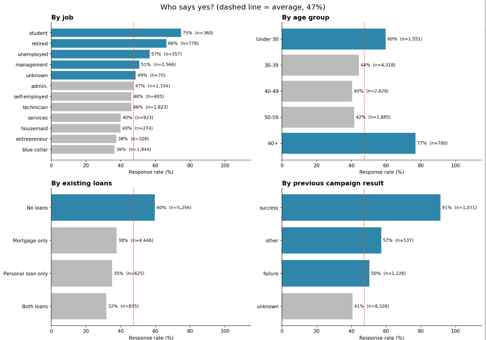

# Bank Marketing Campaign Analysis

**Goal:** Identify which customer segments are most likely to respond to a bank's term-deposit campaign, so the bank can target future calls more efficiently.

**Tools:** SQL (SQLite), Python (Pandas, Matplotlib)

**Data:** Public "Bank Marketing" dataset – 11,162 customers from a Portuguese bank's phone campaign.

👉 [View the full notebook on Kaggle](https://www.kaggle.com/code/edenalhazov/bank-marketing-campaign-analysis)

## Key Findings

1. **Past success is the strongest predictor.** 91% of customers who said yes in the previous campaign said yes again, vs. 41% of customers with no prior contact.
2. **Existing debt lowers response.** Customers with no loans responded at 60%, vs. 32% for customers with both a mortgage and a personal loan.
3. **Age shows a U-shape.** Customers under 30 (60%) and over 60 (77%) respond most; ages 30–59 respond around 40–44%.
4. **Students and retirees lead; blue-collar workers trail** (75% and 66% vs. 36%).

## Recommendation

Prioritize previous responders and customers without existing loans, and give extra focus to the under-30 and 60+ segments.

## Approach

1. Loaded the data into a SQL database (SQLite).
2. Wrote SQL queries with `GROUP BY`, `CASE WHEN` and aggregations to compare response rates across segments.
3. Visualized the results in a 4-panel dashboard with Matplotlib.

*Note: the dataset is roughly balanced between yes/no, so absolute rates are higher than in a real campaign. The comparisons between groups are what matter.*
